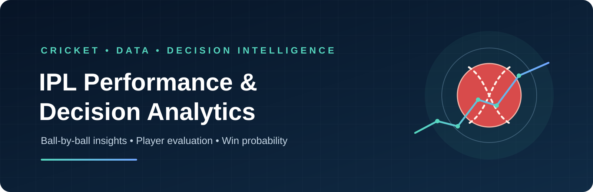
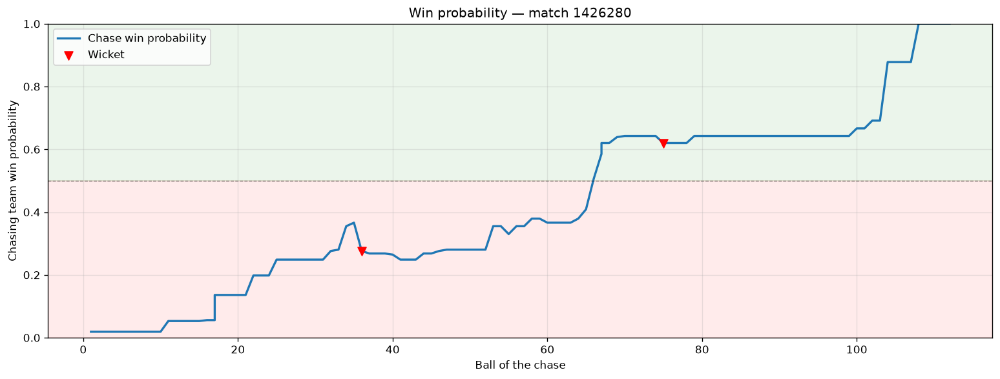

<p align="center">
  
</p>

<p align="center">
  
  
  
  
  
</p>

<p align="center">
  <a href="#dashboard">Dashboard</a> •
  <a href="#key-analytical-work">Methodology</a> •
  <a href="#win-probability-model">Win Probability</a> •
  <a href="#run-the-dashboard-locally">Run Locally</a>
</p>

# IPL Intelligence — Cricket Analytics & Player Strategy

A premium dark sports analytics platform for cricket fans and analysts, combining Python-based match intelligence, player performance analysis, hypothetical franchise recruitment fit, and player shortlisting.

The project uses Cricsheet ball-by-ball data and presents its findings through an interactive Streamlit dashboard.

## Project at a glance

- **Dataset:** 295,557 delivery records across 1,243 matches
- **Coverage in the processed dataset:** 2008–2026
- **Data source:** [Cricsheet](https://cricsheet.org/)
- **Dashboard:** Streamlit, with eight analytical pages
- **Machine learning:** Logistic Regression, StandardScaler, and Isotonic Regression calibration
- **Main predictive task:** Estimate the chasing team's win probability as a match progresses

> **Scope note:** The dashboard analyses historical match data. It is not connected to a live match feed. The Win Probability page replays a selected historical chase ball by ball.

## Dashboard

The Streamlit application contains eight sections:

| Page | What it shows |
|---|---|
| **Overview** | Season-level scoring trends, match counts, delivery counts, and toss-related summaries |
| **Player Profile** | Batting and bowling statistics, including phase-wise batting strike rates |
| **Team Comparison** | Head-to-head results between two selected teams |
| **Venue Insights** | Venue-level first-innings scoring and chasing outcomes |
| **Matchup Explorer** | Batter-versus-bowler records for qualifying matchups |
| **Player Impact** | Player impact rankings based on a project-defined batting and bowling score |
| **Win Probability** | Ball-by-ball estimated chase win probability for a selected historical match |
| **Player Shortlist** | Filter and rank players against hypothetical batting, bowling and all-rounder priorities; export a recruitment shortlist |

### Win Probability preview



The chart illustrates how the estimated probability changes during a chase. The dashboard also provides a delivery-level table containing the match state and estimated probability.

## Key analytical work

### Data preparation

The notebooks build a consolidated analytical dataset from Cricsheet's match files. The processed delivery dataset contains **295,557 rows and 40 columns**, covering **1,243 matches** and seasons from **2008 to 2026**.

Preparation work includes:

- Combining delivery-level files and match information.
- Standardising historical team names and venue names.
- Creating match-state fields such as runs scored, wickets, legal balls, balls remaining, and innings phase.
- Preparing match, batting, bowling, player-impact, and batter-bowler matchup datasets.

The raw source files are not included in the repository; they are excluded through `.gitignore`. The processed CSV files required by the dashboard are included.

### Player roles and impact scoring

Batters are assigned project-defined roles using their batting position, innings patterns, and phase-specific performance. The implemented categories include **Opener, Anchor, Finisher, Middle-order, and Bowler**.

The Player Impact page displays a comparative impact score. The score combines normalised performance indicators and a reliability factor based on opportunities (balls faced or legal balls bowled). The Player Shortlist page applies user-defined role priorities to these historical impact indicators. Its score is a shortlist aid, not a real franchise scouting decision.

**Interpretation:** This is a project-defined performance score, not an estimate of actual IPL auction prices or a financial valuation. Franchise-fit rankings are similarly heuristic and should be reviewed by analysts.

### Matchup analysis

The Matchup Explorer uses batter-bowler aggregates to show balls faced, runs, dismissals, and strike rate for selected pairings. The notebook applies a minimum-ball threshold when identifying qualifying matchups.

## Win Probability model

The Win Probability model estimates the probability that the team batting second will win, based on the state of the chase after each delivery.

**Input features**

- Runs needed
- Balls remaining
- Wickets remaining
- Current run rate
- Required run rate
- Difference between required and current run rate

**Model pipeline**

1. Train a Logistic Regression classifier on historical chase states from **2008–2022**.
2. Use the **2023** season as a separate calibration set.
3. Apply Isotonic Regression to calibrate the model's predicted probabilities.
4. Evaluate the calibrated model on the **2024–2025** holdout seasons.

### Reported holdout performance

| Metric | Result |
|---|---:|
| Accuracy | **82.0%** |
| ROC-AUC | **0.908** |
| Log loss | **0.424** |

The evaluation used 24,433 delivery-level observations from 2024–2025. These are the results of the temporally separated, calibrated evaluation in notebook `07b_winprob.ipynb`.

The notebook also records the uncalibrated model's results on a broader 2023–2025 test split: 78.7% accuracy and 0.887 ROC-AUC. These figures refer to a different evaluation setup and should not be mixed with the calibrated 2024–2025 results above.

### Pre-match prediction

A separate Logistic Regression experiment estimates the outcome before a match using historical team form, home advantage, and head-to-head information.

On its 2023–2025 temporal test set, the saved pre-match model achieved **47.9% accuracy** and **0.475 ROC-AUC**. This result is included as an analytical finding: the selected pre-match features provided limited predictive signal in this experiment.

## Repository structure

```text
IPL-DATA-ANALYTICS/
├── app/
│   └── dashboard.py
├── data/
│   └── processed/
│       ├── batting_stats.csv
│       ├── bowling_stats.csv
│       ├── cleaned_deliveries.csv
│       ├── matches.csv
│       ├── matchups.csv
│       └── player_impact.csv
├── models/
│   ├── prematch_logistic.pkl
│   └── winprob_logistic.pkl
├── notebooks/
│   ├── 01_cleaning.ipynb
│   ├── 02_eda.ipynb
│   ├── 03_batting.ipynb
│   ├── 04_bowling.ipynb
│   ├── 05_matchups.ipynb
│   ├── 06_value_score.ipynb
│   ├── 07a_prematch.ipynb
│   └── 07b_winprob.ipynb
├── reports/
│   └── winprob_1426280.png
├── src/
│   ├── build_consolidated.py
│   ├── download_data.py
│   └── intelligence.py
└── .gitignore
```

## Run the dashboard locally

### Requirements

- Python 3.9 or later
- pip

### 1. Clone the repository

```bash
git clone https://github.com/Pa01-Kumar/IPL-DATA-ANALYTICS.git
cd IPL-DATA-ANALYTICS
```

### 2. Create and activate a virtual environment

**Windows (PowerShell or Command Prompt):**

```bash
python -m venv .venv
.venv\\Scripts\\activate
```

**macOS / Linux:**

```bash
python -m venv .venv
source .venv/bin/activate
```

### 3. Install dependencies

```bash
python -m pip install --upgrade pip
python -m pip install streamlit pandas numpy matplotlib scikit-learn
```

For running the data-download script or exploring the notebooks, also install:

```bash
python -m pip install requests seaborn jupyter pytest
```

### 4. Launch the dashboard

From the repository root, run:

```bash
python -m pytest -q
streamlit run app/dashboard.py
```

Streamlit will print a local address in the terminal, usually `http://localhost:8501`.

The dashboard expects the processed CSV files in `data/processed/` and the saved model files in `models/`. Both are tracked in this repository.

## Reproducing the data preparation

The raw Cricsheet archive is excluded from version control. To download it again, run the following command from the repository root:

```bash
python src/download_data.py
```

Then consolidate the downloaded delivery CSV files:

```bash
python src/build_consolidated.py
```

The notebooks document the subsequent cleaning, analysis, feature engineering, and model development steps. Open them with Jupyter Notebook or JupyterLab.

## Limitations and interpretation

- Win Probability is a model estimate, not a guarantee of the match result.
- The reported 82.0% accuracy and 0.908 ROC-AUC apply to the calibrated 2024–2025 holdout evaluation described above.
- The model was trained on data through 2022 and calibrated using 2023 data. Performance on later seasons or future rule changes may differ.
- The project does not estimate player prices. Player Shortlist ranks existing players using historical batting and bowling impact, with analyst-controlled role priorities. Rankings are statistical decision support, not official franchise recommendations.
- The application currently works with historical data and does not ingest live scores.
- Pre-match prediction performance is limited with the features used in the current experiment.

## Quality checks

A GitHub Actions workflow runs the Python unit tests on pushes to the upgrade branch and pull requests targeting `main`. Run the same checks locally with `python -m pytest -q`.

## Future improvements

- Add automated data validation and a reproducible dependency file.
- Expand model evaluation across additional seasons and match conditions.
- Explore richer player-form, venue, and team-combination features.
- Improve explanations of the factors behind each probability estimate.
- Add live-score integration as a separate future capability.

## Acknowledgements

- [Cricsheet](https://cricsheet.org/) for providing the ball-by-ball cricket data used in this project.
- The open-source Python ecosystem, including Pandas, NumPy, scikit-learn, Matplotlib, and Streamlit.

## Author

**N PAVAN KUMAR**  
B.E. – Computer Science and Engineering (AI & ML)  
East Point College of Engineering and Technology

---

*Developed as a learning and portfolio project exploring cricket analytics, data science, and machine learning.*
